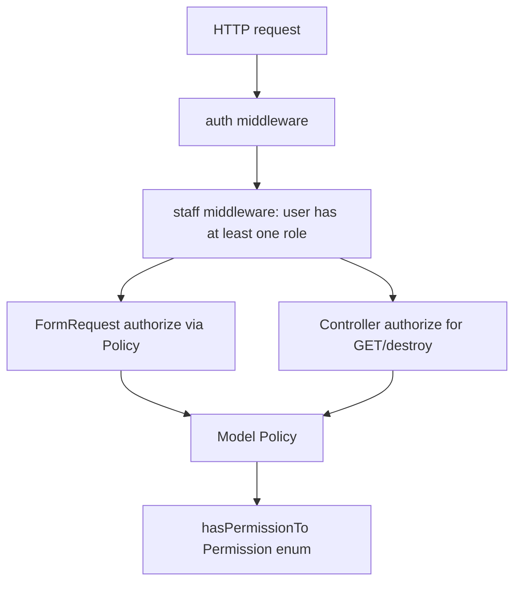
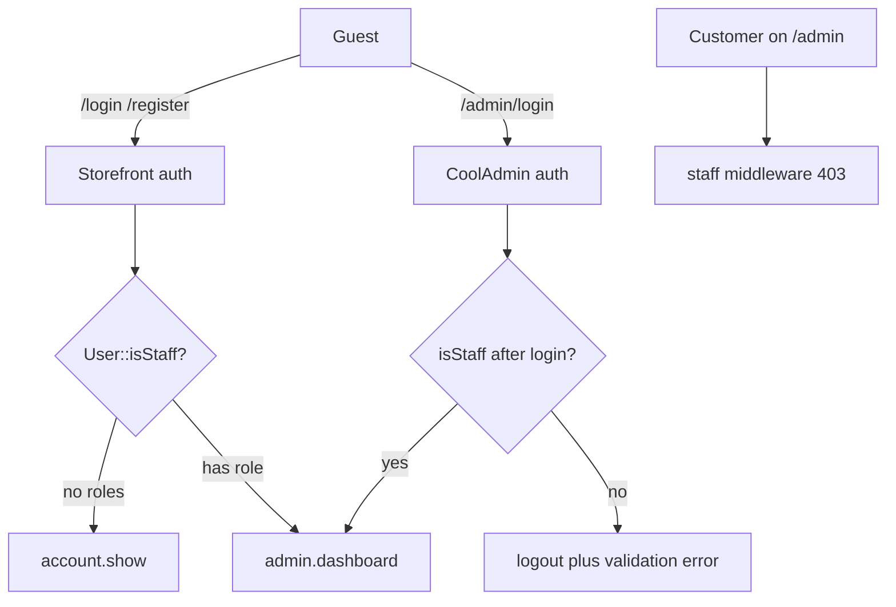
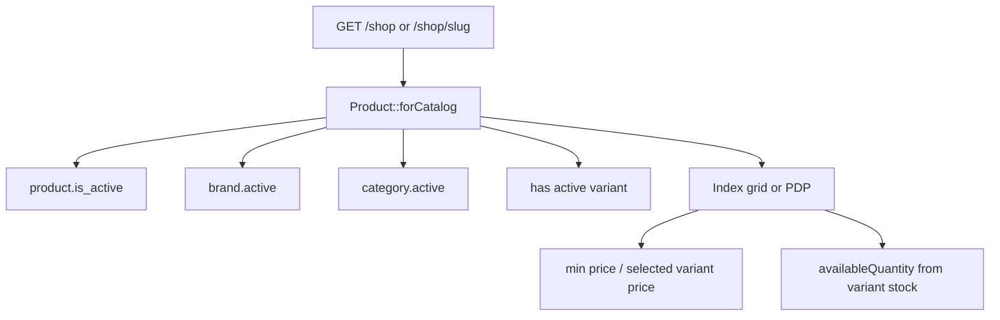
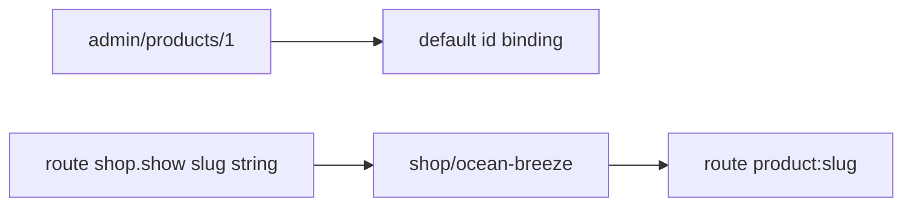
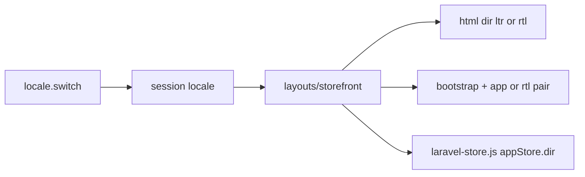
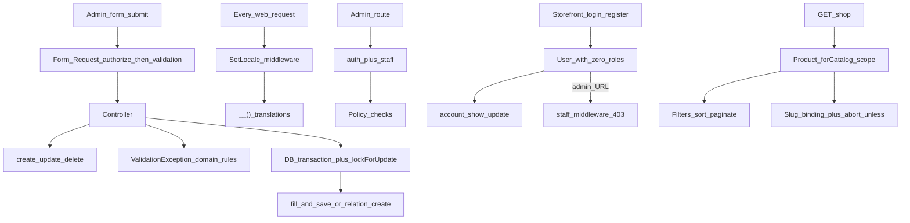

# Phase-by-Phase Learning Guide (Phases 1–5)

Study guide based on [`PROJECT_STATUS.md`](PROJECT_STATUS.md) and what exists in the app today.

---

## Phase 1 — Project Foundation

**Tasks:** Inspect Laravel app, MySQL config, CoolAdmin assets under `public/cooladmin`, admin/auth Blade layouts, dashboard routes, app name/timezone.

**Authentication (done):** Session login/logout, remember me. Admin login lives at `/admin/login` (CoolAdmin). Customer login/register live on the MaleFashion storefront (Phase 5).

**Authorization (done):** Layered staff access — Spatie roles/permissions, `staff` middleware, Policies, Form Request + controller `authorize()`, sidebar `@can`, Users/Roles admin UI.

### How authorization works in this app

1. **`auth`** — must be logged in.
2. **`staff` (`EnsureUserIsStaff`)** — must have **at least one** Spatie role (customers later will have none → blocked from admin).
3. **Policies** — fine-grained: e.g. `BrandPolicy::create` checks `brands.create`.
4. **Wiring**
   - Form Requests: `$this->user()?->can('create', Brand::class)`
   - Controllers (index/create/edit/show/destroy): `$this->authorize(...)`
   - Dashboard: `$this->authorize(Permission::DashboardView->value)` (Spatie registers permission names with Gate)
5. **Sidebar** — `@can` / `can('viewAny', …)` hides links the user cannot use.

**Roles (seeded):**

| Role | Access |
|------|--------|
| `super_admin` | All permissions, including Administration (Users/Roles). Protected system role. Seeded user gets this. |
| `admin` | All permissions **except** `users.*` and `roles.*`. |

Each staff user has **exactly one role** in the UI (`role_id` select + `syncRoles([$name])`). Spatie still stores roles via pivot; we simply assign one.

**Permission catalog:** backed enum `App\Enums\Permission` → seeded in `RolePermissionSeeder`. Policies call `$user->hasPermissionTo(Permission::…)` (not `$user->can()` inside the policy) to avoid Gate recursion.

**Spatie `Role` model policy:** `Gate::policy(Role::class, RolePolicy::class)` in `AppServiceProvider` because `Spatie\Permission\Models\Role` is not under `App\Models`, so auto-discovery does not apply. `UserPolicy` auto-discovers normally.

**Why both `staff` and Policies?**  
`staff` = may enter the admin area. Policies = which modules/actions that staff member may use. Ready for limited roles without opening admin to every logged-in user.

### Topics

- **Blade layouts / partials** — Shared HTML shell (`layouts/admin`, sidebar, header) so every page reuses one design.
- **Public assets** — CoolAdmin CSS/JS/fonts served from `public/`, referenced with `asset()`.
- **Named routes + route groups** — `prefix('admin')->name('admin.')` keeps URLs and names organized.
- **Invokable controllers** — Single-action controllers (dashboard) with `__invoke`.
- **Session authentication** — `web` guard stores the logged-in user id in the session.
- **`auth` / `guest` middleware** — Guests cannot open admin pages; logged-in users skip the login form.
- **Session regenerate on login** — Prevents session fixation after `Auth::attempt`.
- **Spatie roles & permissions** — Roles group permissions; `$user->hasPermissionTo()` / `$user->can()` check access.
- **Laravel Policies** — Map abilities (`viewAny`, `create`, `update`, `delete`) to permission checks.
- **`AuthorizesRequests`** — On base `Controller` so `$this->authorize()` works.
- **Form Request `authorize()`** — Second gate after validation class is resolved (before `rules()` run for writes).
- **Blade `@can`** — UX only; real enforcement is middleware + Policies.

### Key functions

| Function | Takes | Returns / does |
|----------|-------|----------------|
| `route('name')` | Route name (+ params) | URL string for that route |
| `view('admin.x', $data)` | View name + array | Renders Blade HTML |
| `asset('cooladmin/...')` | Path under `public/` | Public URL to CSS/JS/images |
| `config('app.name')` | Config key | Value from `config/*.php` |
| `Auth::attempt($credentials, $remember)` | email/password array + remember bool | `true` if login succeeds; starts session |
| `$request->session()->regenerate()` | — | New session id after login |
| `Auth::logout()` | — | Clears authenticated user from session |
| `$this->actingAs($user)` | User model | Fakes login in tests |
| `redirectGuestsTo(fn (Request $r) => ...)` | Closure returning URL | Where `auth` middleware sends guests (admin vs storefront paths) |
| `$user->assignRole` / `syncRoles` | Role name(s) | Attach role(s); `syncRoles` replaces the set |
| `$user->hasPermissionTo($permission)` | Permission enum/string | `true` if role grants that permission |
| `$user->can('create', Brand::class)` | Ability + model/class | Runs matching Policy method via Gate |
| `$this->authorize('update', $brand)` | Ability + model | Aborts 403 if Policy denies |
| `Gate::policy(Role::class, RolePolicy::class)` | Model class + Policy class | Manual Policy map for non-`App\Models` types |
| `@can('viewAny', Brand::class)` | Ability + model/class | Shows Blade block only if allowed |
| `actingAsAdmin()` / `actingAsAdminWithout(...)` | Optional Permission enums | Test helpers: seed roles, login as `super_admin` (optionally revoke perms) |

---

## Phase 2 — Brands

**Tasks:** Migration, model, factory, Form Requests, CRUD, search/filter/pagination, logo upload, tests.

### Topics

- **Migrations** — Define table columns once; `php artisan migrate` applies them.
- **Eloquent models + `$fillable` / `#[Fillable]`** — Whitelist mass-assignable attributes.
- **Soft deletes** — `deleted_at` instead of hard delete; rows hidden by default.
- **Form Request classes** — Validation lives outside the controller (`StoreBrandRequest`, etc.).
- **`prepareForValidation()`** — Normalize input (e.g. slug) before rules run.
- **File uploads + Storage** — Store logo on `public` disk; delete old file on replace.
- **Query scopes** — e.g. `scopeActive` → `$query->active()`.
- **Feature tests + factories** — Simulate HTTP requests; seed models easily.

### Key functions

| Function | Takes | Returns / does |
|----------|-------|----------------|
| `Brand::create($attrs)` | Array of attributes | New saved `Brand` model |
| `$brand->update($attrs)` | Array | Updates row; returns bool |
| `$brand->delete()` | — | Soft-deletes (sets `deleted_at`) |
| `$request->validated()` | Optional field key | Validated data array (or one value) |
| `Str::slug($text)` | String | URL-safe slug string |
| `filled($value)` | Mixed | `true` if not empty |
| `$file->store($path, 'public')` | Folder + disk | Relative path string of stored file |
| `Storage::disk('public')->delete($path)` | File path | Deletes file from disk |
| `paginate(15)` | Per-page int | Length-aware paginator |
| `withQueryString()` | — | Keeps `?search=&status=` on page links |
| `to_route('admin.brands.index')` | Route name | Redirect response to that route |
| `->with('success', $msg)` | Flash key + message | Stores flash in session for next request |
| `Rule::unique(...)->ignore($id)` | Table/column + id | Unique rule that allows current row on update |
| `$model->getKey()` | — | Primary key value (usually `id`) — safer than hardcoding `->id` |

---

## Phase 2 — Categories

**Tasks:** Hierarchy (`parent_id`), CRUD, search/filter, cycle prevention, views, tests.

### Topics

- **Self-referencing relationships** — Category `belongsTo` parent / `hasMany` children.
- **Eager loading (`with`)** — Avoid N+1 when listing parent names.
- **Business rule validation** — Not only Form Request rules; controller logic blocks parent = descendant.
- **`ValidationException`** — Turn a domain error into a normal validation error (redirect + errors bag).
- **`whereKeyNot`** — Exclude current category from parent dropdown.

### Key functions

| Function | Takes | Returns / does |
|----------|-------|----------------|
| `->with('parent:id,name')` | Relation (+ columns) | Eager-loads parent; returns query/collection with relation set |
| `when($cond, $callback)` | Condition + closure | Applies `where` only if condition true |
| `whereKeyNot($id)` | Primary key | Excludes that model from query |
| `pluck('id')` | Column | Collection of that column’s values |
| `ValidationException::withMessages([...])` | Field => message map | Throws; Laravel redirects back with errors |
| `$category->children()->update([...])` | Attributes | Mass-updates related rows (orphan children on delete) |

---

## Phase 2 — Products

**Tasks:** Product table with brand/category FKs, CRUD, filters, show page, soft deletes, tests.

### Topics

- **Foreign keys + `belongsTo` / `hasMany`** — Product → Brand, Category; Brand/Category → products.
- **Route model binding** — `edit(Product $product)` loads model from `{product}` or 404.
- **Eager loading multiple relations** — `with(['brand:id,name', 'category:id,name'])`.
- **Unique slug/SKU with ignore on update** — `Rule::unique()->ignore($product)`.

### Key functions

| Function | Takes | Returns / does |
|----------|-------|----------------|
| `$this->belongsTo(Brand::class)` | Related model class | `BelongsTo` relation object |
| `$this->hasMany(ProductVariant::class)` | Related model class | `HasMany` relation object |
| `$product->load('variants')` | Relations | Loads relations onto existing model; returns model |
| `Rule::unique('products', 'slug')->ignore($product)` | — | Unique except this product’s row |

---

## Phase 2 — Product Variants

**Tasks:** Nested routes under product, volume/unit/price, Form Requests, duplicate volume validation, show-page preview.

### Topics

- **Nested resource routes** — `products.variants` → URLs like `/admin/products/{product}/variants`.
- **Ownership checks** — `abort_unless($variant->product_id === $product->getKey(), 404)` so URL can’t mix product A + variant of B.
- **Conditional unique rules** — Same volume+unit only once per product (`Rule::unique(...)->where(...)`).
- **Accessors** — `getDisplayNameAttribute` → `$variant->display_name`.
- **Casts** — decimals/booleans cast automatically.

### Key functions

| Function | Takes | Returns / does |
|----------|-------|----------------|
| `abort_unless($condition, 404)` | Bool + status | Continues if true; aborts HTTP error if false |
| `Rule::in(['ml', 'oz'])` | Allowed list | Validation rule |
| `Rule::unique(...)->where(fn)` | Extra query constraints | Scoped uniqueness |
| `$variant->getKey()` | — | Variant’s primary key |

---

## Phase 2 — Product Images

**Tasks:** Gallery table, multi-upload, sort order, delete DB row + file, nested routes.

### Topics

- **Multi-file upload** — `images[]` validated in Form Request; loop + `store()`.
- **Keeping disk + DB in sync** — Delete `Storage` file when deleting image row.
- **Ordered `hasMany`** — Images ordered by `sort_order`.

### Key functions

| Function | Takes | Returns / does |
|----------|-------|----------------|
| `$image->store("products/{$id}", 'public')` | Path + disk | Stored relative path |
| `Storage::disk('public')->delete($path)` | Path | Removes physical file |
| `$product->images()->create([...])` | Attributes | Creates related `ProductImage` and saves |

---

## Phase 3 — Stock / Inventory

**Tasks:** One stock row per variant (physical, reserved, available, low-stock threshold); inventory index + settings; no direct physical edit from settings anymore (movements own that).

### Topics

- **One-to-one (`hasOne` / `belongsTo`)** — Variant ↔ `ProductVariantStock`.
- **Database transactions** — Multiple writes succeed or fail together.
- **`lockForUpdate()`** — Row-level lock inside a transaction (prevents race conditions if two admins update stock at once).
- **`fill()` vs assigning FKs** — Mass-assign safe fields; set `product_variant_id` explicitly when creating.
- **Derived values** — `availableQuantity()` = physical − reserved (computed, not always a DB column write).
- **`whereHas`** — Filter variants whose product is active.

### Key functions

| Function | Takes | Returns / does |
|----------|-------|----------------|
| `DB::transaction(function () { ... })` | Closure | Runs closure in a DB transaction; commits on success, rolls back on exception; returns closure’s return value |
| `->lockForUpdate()` | — | `SELECT ... FOR UPDATE` on the query; returns same query builder |
| `findOrFail($id)` | Primary key | Model, or throws `ModelNotFoundException` (404) |
| `$stock->fill([...])` | Attribute array | Sets attributes on model **in memory**; does **not** save; returns `$stock` |
| `$stock->save()` | — | INSERT or UPDATE; returns bool |
| `$stock->exists` | — (property) | `true` if model already has a DB row |
| `$variant->stock()->first()` | — | Related stock model or `null` |
| `whereHas('product', fn ($q) => ...)` | Relation + constraint | Only parents that have matching related rows |

**Why `getKey()` here?**  
`findOrFail($variant->getKey())` and `$stock->product_variant_id = $variant->getKey()` use the real primary key without assuming the column is named `id`.

**Why `fill()`?**  
Sets `reserved_quantity` / `low_stock_threshold` in one call respecting fillable; then `save()` persists. FK is set separately when the row is new.

---

## Phase 3 — Stock Movements

**Tasks:** Append-only ledger (`in`/`out`), atomic stock change + movement row, outgoing cannot eat reserved qty, history UI, opening-balance migration seed.

### Topics

- **Ledger / audit pattern** — Don’t silently change stock; record every change.
- **Same transaction for balance + movement** — If movement insert fails, stock update rolls back.
- **`withTrashed()` on nested eager load** — History still shows soft-deleted variants/products.
- **`Rule::exists(...)->where(...)`** — Variant must exist and be active (and product active).

### Key functions

| Function | Takes | Returns / does |
|----------|-------|----------------|
| `$stock->movements()->create([...])` | Attributes | Creates movement linked to this stock; returns model |
| `->with(['stock.variant' => fn ($q) => $q->withTrashed()])` | Nested relations + constraints | Eager-loads including soft-deleted |
| `latest('id')` | Column | Orders newest first |
| `Rule::exists('product_variants', 'id')->where(...)` | Table + extra where | Exists rule with conditions |

---

## Phase 4 — Localization (EN/AR)

**Tasks:** Session locale, `SetLocale` middleware, switch route, `lang/en` + `lang/ar`, `__()` everywhere, RTL CSS, language switcher, tests.

### Topics

- **Session as user preference store** — Remember `locale` across requests.
- **Web-group (“global”) middleware** — Registered in [`bootstrap/app.php`](bootstrap/app.php) via `$middleware->web(append: ...)`, not per-route in `web.php`.
- **Translation files + `__()`** — UI strings live in `lang/{locale}/*.php`.
- **Config-driven locales** — `available_locales` holds label + `dir` (ltr/rtl).
- **RTL front-end** — `dir="rtl"`, Bootstrap RTL, `rtl.css`.
- **Route `whereIn`** — Constrain `{locale}` to allowed codes.

### Key functions

| Function | Takes | Returns / does |
|----------|-------|----------------|
| `$request->session()->put('locale', $locale)` | Key + value | Stores in session; returns void |
| `$request->session()->get('locale', $default)` | Key + default | Session value or default |
| `App::setLocale($locale)` | Locale string | Sets active locale for `__()` this request |
| `__('admin.nav.brands')` | Key (+ replace + locale) | Translated string |
| `abort_unless(in_array(...), 404)` | Condition + status | Guard invalid locale in controller |
| `config('app.available_locales')` | Key | Locale map from config |
| `back()` | — | Redirect to previous URL |
| `array_keys($array)` | Associative array | List of keys (`['en','ar']`) |

---

## Phase 5 — Customer Accounts (MaleFashion)

**Tasks:** Integrate MaleFashion storefront assets/layout, public home shell, split admin vs customer auth URLs, customer register/login/logout + account profile, EN/AR storefront strings, tests.

### How customer vs staff access works

1. **One `users` table** — Customers and staff share `App\Models\User`. No separate customers table.
2. **Customer = zero Spatie roles** — Registration creates a user and never calls `assignRole`.
3. **Staff = at least one role** — `User::isStaff()` / `staff` middleware; Policies still fine-tune modules.
4. **Split login URLs**
   - Storefront: `/login`, `/register`, `/logout`, `/account` (MaleFashion Blade).
   - Admin: `/admin/login`, `/admin/logout` (CoolAdmin).
5. **Smart redirects in [`bootstrap/app.php`](bootstrap/app.php)**
   - Guests hitting `admin*` → `admin.login`; otherwise → `login`.
   - Authenticated users hitting guest-only pages → staff to `admin.dashboard`, customers to `home`.
6. **Admin login rejects non-staff** — After `Auth::attempt`, if `! $user->isStaff()`, logout and throw `ValidationException` (customers cannot use the admin form).
7. **Customer login accepts staff** — Staff who use `/login` are redirected to `admin.dashboard` (convenient, not a second account).

### Topics

- **Second UI template in one Laravel app** — CoolAdmin for admin, MaleFashion for storefront; separate asset trees (`public/cooladmin`, `public/malefashion`) and Blade layouts.
- **Extracting a layout from a static HTML theme** — Copy CSS/JS/img/fonts; turn repeated header/footer into Blade partials; replace relative paths with `asset()`.
- **Public vs protected route groups** — Home is public; account requires `auth`; admin still `auth` + `staff`.
- **Registration without a role** — Creates a customer; admin area stays closed by design.
- **Optional password on profile update** — `nullable` + `confirmed` + `Password::defaults()`; only hash/save when filled.
- **`redirect()->intended(...)`** — After login, send user to the URL they originally tried (or a default).
- **Namespaced storefront code** — Controllers under `App\Http\Controllers\Storefront`, views under `resources/views/storefront`, lang under `storefront.*`.
- **Context-aware guest redirect** — Same `auth` middleware, different login page depending on path.

### Key functions

| Function | Takes | Returns / does |
|----------|-------|----------------|
| `$user->isStaff()` | — | `true` if user has any Spatie role |
| `Auth::login($user)` | User model | Logs in without password (after register) |
| `Auth::attempt($credentials, $remember)` | email/password + remember | Starts session if credentials match |
| `redirect()->intended($defaultUrl)` | Fallback URL | Goes to session “url.intended” or fallback |
| `Password::defaults()` | — | App-wide password rule object for validation |
| `Rule::unique('users', 'email')->ignore($user->id)` | — | Unique email except current user on account update |
| `$request->safe()->except(['password', ...])` | Keys to drop | Validated data without those keys |
| `$request->filled('password')` | Field name | `true` if password was submitted non-empty |
| `$request->is('admin', 'admin/*')` | Path patterns | `true` when current request path matches |
| `asset('malefashion/css/style.css')` | Path under `public/` | Public URL for storefront assets |
| `__('storefront.auth.login_title')` | Lang key | Translated storefront string |

**Why not a `customer` Spatie role?**  
Staff detection is “has any role.” Giving every shopper a `customer` role would make `staff` middleware treat them as admin-area users unless we rewrote the check. Zero roles = customer is the simplest rule and matches Phase 1 design.

**Why two logout routes?**  
Admin header posts to `admin.logout` (CoolAdmin redirect back to `/admin/login`). Storefront posts to `logout` (redirect to storefront `home`). Same session guard; different UX after logout.

---

## Phase 5 — Product Catalog (MaleFashion)

**Tasks:** Public shop listing + product detail pages, catalog visibility scopes, filters/sort/pagination, MaleFashion shop/PDP Blade, EN/AR shop strings, wire nav/search/home CTA, feature tests. No cart yet (add-to-cart UI is disabled / coming soon).

### How catalog visibility works

1. **Admin data, public read model** — No new tables. Shop reads the same `products`, `product_variants`, `product_images`, brands, categories, and stock rows the admin already manages.
2. **`scopeForCatalog()`** — One place defines “sellable on the storefront”: active product + active brand + active category + at least one active variant.
3. **Out of stock still listed** — Missing stock or `availableQuantity() === 0` shows an out-of-stock label; the product is not hidden (browsing stays useful).
4. **Price lives on variants** — Cards show “from” the minimum active variant price. PDP picks a volume and updates price/stock with small client JS.
5. **Images are product-level** — Gallery uses `asset('storage/'.$image->path)` (same as admin). Placeholder MaleFashion image if none.
6. **Cart deferred** — PDP button is disabled with coming-soon copy so we do not half-implement Phase 5 cart.

### Custom slug binding without breaking admin IDs

- Storefront routes: `GET /shop/{product:slug}` → Laravel resolves `Product` where `slug = …`.
- Admin routes stay `{product}` → still bind by primary key.
- **Do not** override `Product::getRouteKeyName()` to `slug`, or admin URLs would switch to slugs globally.
- When generating shop links, pass the slug string: `route('shop.show', $product->slug)` (not only the model), so the URL is `/shop/ocean-breeze` not `/shop/1`.

### Topics

- **Reusable query scopes for a “channel”** — Admin lists everything (with filters); storefront always applies `forCatalog()`. Same model, different audience rules.
- **Explicit custom route key** — `{product:slug}` on one route group only; keeps SEO URLs without changing the model’s default key.
- **Filtering with `when` + `whereHas`** — Search on name/slug/sku/short description; brand/category filter by **slug** (public-friendly query strings), not internal ids.
- **Sort by related aggregate** — `price_asc` / `price_desc` use `orderByRaw` with a correlated `min(product_variants.price)` subquery (only active, non-deleted variants).
- **Eager loading for N+1** — Index loads brand, first image, active variants + stock; show loads full gallery and related products in the same category.
- **`abort_unless` after binding** — Route may find an inactive product by slug; controller re-checks `forCatalog()` and 404s if not visible.
- **Blade partial for cards** — `storefront/partials/product-card` shared by shop grid and related products.
- **Theme porting (shop + shop-details)** — Reuse MaleFashion markup; drop clothing-only sidebar (size/color/tags); keep categories/brands/search/sort.
- **Progressive UI without next feature** — Disabled add-to-cart preserves layout for the upcoming cart task.
- **Storefront feature tests** — Factories build “catalog-ready” products (active brand/category/variant); assert hidden inactive paths and filter/PDP behavior.

### Key functions

| Function | Takes | Returns / does |
|----------|-------|----------------|
| `Product::query()->forCatalog()` | — | Query limited to storefront-visible products |
| `ProductVariant::query()->active()` / `$q->active()` | — | Only `is_active = true` variants |
| `whereHas('brand', fn ($q) => $q->where('slug', $slug))` | Relation + constraint | Filter products by related brand slug |
| `$request->string('search')->trim()->value()` | — | Trimmed search string or empty |
| `in_array($sort, [...], true)` | Value + allow-list + strict | Validates sort against known options |
| `orderByRaw('(select min(...) from product_variants where ...)')` | SQL fragment | Sort products by cheapest active variant |
| `paginate(12)->withQueryString()` | Per-page | Paginator that keeps `?search=&brand=` on links |
| `abort_unless($isVisible, 404)` | Bool + status | 404 when product is not catalog-visible |
| `whereKeyNot($product->getKey())` | Primary key | Exclude current product from related list |
| `route('shop.show', $product->slug)` | Slug string | Public PDP URL using slug segment |
| `$variant->stock?->availableQuantity()` | — | Sellable qty, or treat missing stock as 0 |
| `$collection->min('price')` | Column | Lowest price among loaded variants |
| `@selected($filters['sort'] === 'latest')` | Bool | Marks `<option>` selected in Blade |
| `asset('storage/'.$path)` | Relative storage path | Public URL for uploaded product images |

**Why `forCatalog()` instead of copying `where` clauses in index and show?**  
One definition of “on sale publicly” prevents drift (e.g. show allowing a product that index never lists). Related products reuse the same scope.

**Why filter by brand/category slug in the query string?**  
Public URLs stay readable and stable (`?brand=maison-rose`). Admin filters can keep using ids; storefront prefers slugs for SEO and shareable links.

**Why not implement add-to-cart here?**  
Roadmap order is catalog → cart → checkout. A working button without reservation/session cart would lie to the shopper. Disabled CTA documents the next step without fake behavior.

---

## Phase 5 — Kalles Storefront Redesign (Catalog UI)

**Tasks:** Replace MaleFashion customer UI with curated Kalles assets; rebuild storefront layout/chrome; rebuild shop listing + PDP; restyle home/auth/account; wire Laravel locale into Kalles built-in RTL/LTR; remove `public/malefashion`. Backend catalog contracts unchanged.

### How Kalles RTL/LTR is driven by Laravel

1. **Template already supports both directions** — Kalles ships LTR and RTL CSS (`bootstrap-rtl.min.css`, `app-rtl.min.css`), `[dir="rtl"]` rules, and Alpine `store.js` stylesheet swapping.
2. **Laravel owns the language choice** — `SetLocale` + `locale.switch` remain the control; no competing footer LTR/RTL demo toggle.
3. **First paint is server-correct** — Blade picks the CSS pair from `config('app.available_locales.*.dir')` before Alpine runs.
4. **`public/kalles/js/laravel-store.js`** — initializes Alpine `appStore.dir` from `data-kalles-dir` and uses Laravel `asset()` URLs (not relative `assets/css/...`).

### Topics

- **Curating a large HTML theme** — Copy only must-have CSS/JS/libs/fonts/images from `kalles/.../dist/assets` into `public/kalles`; leave the gitignored `kalles/` folder untouched as reference.
- **Handlebars → Blade** — Theme partials become `layouts/storefront` + `storefront/partials/*`.
- **Preserving backend contracts while swapping UI** — Same routes, `ShopController`, scopes, query params, and translation keys; only markup/assets change.
- **Vendored Alpine/jQuery** — Ship as static files under `public/kalles/libs` (same idea as CoolAdmin jQuery), not new Composer/npm app deps.
- **Volume as swatches** — Reuse Kalles size/rectangle swatch classes for perfume volumes instead of clothing colors.

### Key functions / paths

| Piece | Role |
|-------|------|
| `asset('kalles/css/app.min.css')` | Public URL for curated theme CSS |
| `data-kalles-dir` / `laravel-store.js` | Align Alpine direction with session locale |
| `route('shop.show', $product->slug)` | PDP URL without changing admin ID binding |
| `topbar-product-card` | Kalles product card class used in listing + related |

**Why not copy the entire Kalles tree?**  
Most demos (blog, portfolio, niche homes) are unused weight. AGENTS.md requires copying only required assets.

**Why keep MaleFashion removed from `public/`?**  
One official storefront template avoids mixed class names and duplicate asset maintenance. Root `malefashion-master/` can remain as an ignored archive only.

### Home Classic full-experience port

- **Source of truth:** `kalles/HTML/HTML/dist/home-classic.html` (compiled Handlebars), not a hand-built slim hero.
- **Shared chrome:** `top-banner` + `header2` + classic `footer` + `popup` + full `card-model` so Quick View, cart sidebar, search, and account offcanvas match the theme.
- **Asset rewrite:** `assets/...` → `asset('kalles/...')`; watch nested quotes in CSS `url()` (use `style='... url("{{ asset(...) }}") ...'`).
- **Locale vs demo toggle:** keep Laravel `locale.switch`; remove/disable Kalles footer LTR/RTL toggle so direction stays session-owned.
- **Cleanup later:** blog/Instagram/demo mega menus stay until you request removal — useful to validate Flickity/Swiper/modals first.

---

## Quick “when do I use this?” map

---

## Suggested study order (if re-reading code)

1. Auth login/logout + `Auth::attempt` + `auth`/`guest` middleware + `actingAs`
2. Spatie seed (`RolePermissionSeeder`) + `Permission`/`Role` enums + `staff` middleware
3. One Policy (e.g. `BrandPolicy`) + Form Request `authorize()` + controller `$this->authorize()`
4. Users/Roles admin + single `role_id` + `super_admin` vs `admin` permission split
5. Brands CRUD + Form Request + `Str::slug` + Storage
6. Categories hierarchy + `ValidationException` cycle check
7. Nested variants/images + `abort_unless` + `getKey()`
8. Inventory `DB::transaction` + `lockForUpdate` + `fill()`
9. Stock movements ledger inside the same transaction
10. Locale middleware vs switch route
11. Kalles curated assets in `public/kalles` + Blade layout/partials
12. Split admin/customer auth routes + `User::isStaff()` + `redirectGuestsTo` / `redirectUsersTo`
13. Storefront register/login/account Form Requests + optional password update
14. `Product::forCatalog()` + `ProductVariant::scopeActive()` + shop filters/`when`/`whereHas`
15. `{product:slug}` binding vs admin id binding + `route('shop.show', $slug)`
16. Kalles shop/PDP Blade + Laravel-driven Kalles RTL/LTR + `StorefrontCatalogTest`

**Not used yet (later phases):** Shopping cart/session, checkout, customer addresses, Events/Listeners, Jobs/Queues, API Sanctum, email verification, password reset emails. Volume unit is still `Rule::in` (not an Enum).
